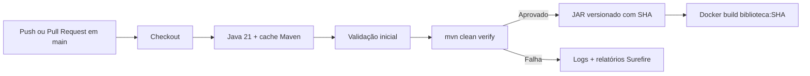

# Modelo do Pipeline CI — Trabalho 5

## Diagrama

## Gatilho

| Evento | Comportamento |
|---|---|
| `push` em `main` | Executa pipeline completo |
| `pull_request` para `main` | Executa pipeline completo |
| `workflow_dispatch` | Execução manual |

Arquivo: [`.github/workflows/ci.yml`](../.github/workflows/ci.yml)

## Etapas

| Etapa | Entrada | Ação | Saída | Falha |
|---|---|---|---|---|
| Checkout | Evento Git | `actions/checkout@v4` | Código no workspace | Sem código → interrompe |
| Java + cache | Código | Temurin 21 + cache Maven | Ambiente pronto | Setup falhou → interrompe |
| Validação inicial | Estrutura | Verifica `pom.xml` e fontes | OK estrutural | Arquivo ausente → interrompe |
| Build e testes | Código | `./mvnw -B clean verify` | Classes + relatórios | Compilação/teste falhou → interrompe |
| Relatórios | `target/surefire-reports` | Upload artifact (`always`) | Evidência de testes | Aviso se vazio |
| Artefato | JAR em `target/` | Upload artifact (`success`) | `pacote-<sha>` | Sem JAR → erro |
| Docker | Código aprovado | `docker build -t biblioteca:<sha>` | Imagem local no runner | Build Docker falhou → interrompe |

## Artefato

- Nome: `pacote-<commit-sha>`
- Conteúdo: JAR gerado em `target/`
- Rastreabilidade: SHA do commit + execução do workflow no GitHub Actions

## Dependências

- Java 21 (Temurin)
- Apache Maven (wrapper `./mvnw`)
- Docker (disponível no runner `ubuntu-latest`)

## Riscos e mitigações

| Risco | Mitigação |
|---|---|
| Testes insuficientes | Testes unitários de empréstimo + teste de contexto Spring |
| Segredo exposto | JWT via `JWT_SECRET`; fallback apenas local; secrets no GitHub |
| Imagem sem versão única | Tag `biblioteca:<github.sha>` |
| Ambiente de teste diferente | Build limpo no runner a cada execução |
| Dependência indisponível | Maven Central + cache; falha explícita no log |
| Permissão excessiva | `permissions: contents: read` |

## Proteção de segredos

- Não há tokens, senhas de produção ou chaves privadas no repositório.
- `api.security.token.secret` lê `${JWT_SECRET}` (ver `.env.example`).
- No CI atual não é necessário secret para build/testes.
- Se no futuro houver publicação em registry, usar **GitHub Secrets** e nunca imprimir o valor nos logs.
